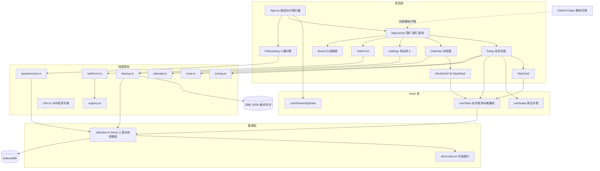

## 用户原始需求

- 继续推进「时光扣 TimePin」的下一个大步骤，先给出计划再实施。
- 本轮覆盖总纲 Step 4–7 的核心业务闭环：任务卡片与首页真实列表、任务新建与编辑表单、首次紧急度问卷、日历月视图与颜色条。
- 交付 GitHub Pages 自定义域名的完整静态发布产物：自动构建工作流、自定义域名文件、深层链接回退与部署说明；域名形态为 timepin.tools.leleleling.site。
- 提供导出与导入 JSON 的本机数据迁移能力，并在设置页给出「换域名后本机数据不跟随」的可读提示。
- 全程免费、零账号、零密钥、零后端；本轮不实现任何到期提醒与推送能力。
- 所有新增界面文案中英双语，沿用既有浅深色双主题、设计令牌与 200ms 动效规范。

## 产品概述

「时光扣」以首次问卷校准出的紧急度为核心，把任务按四象限智能排序。本轮把基础骨架变成可日常使用的任务应用：创建、编辑、完成、置顶、延后、删除、搜索筛选，并能按日期回看任务；同时具备把本机数据带到自定义域名的能力。发布后仍是纯静态、离线可用、无账号的本地优先应用。

## 核心功能

- 任务闭环：卡片列表、4px 重要度色条、圆形勾选框、紧急度徽标、移动端左右滑与桌面等价操作按钮。
- 表单闭环：大字号无边框标题、内容与日期时间、重要度与标签、保存校验、紧急度算分、新建与编辑、URL 参数预填。
- 紧急度闭环：十题问卷逐题作答、五档选项映射分数、跳过使用默认值、未完成前强制路由拦截且保留表单预填、完成后为任务打分并排序。
- 日历闭环：七列月视图网格、每日最多三条 3px 色条、点击弹出当日任务清单、年周日月档位中仅月视图实现其余保留说明。
- 数据迁移：导出含版本号与三张表数据的 JSON、导入前结构校验与确认摘要、合并或覆盖两种模式、设置页迁移提示。
- 静态发布：仓库内自动构建工作流、自定义域名文件、404 深链回退与路径恢复脚本、部署与 DNS 说明。
- 视觉一致性：浅色与深色双主题、中英即时切换、红橙灰主色、卡片与胶囊标签、桌面限宽列与移动端安全区、统一微动效。

## 技术栈选型

基于已核实的现有工程，全部复用、不引入新架构模式：

- React 18.3 + TypeScript 5.6 + Vite 5.4 + Tailwind CSS 3.4.17（已锁定，配置保持 v3 写法：postcss、autoprefixer、tailwind.config.js、`@tailwind` 注入）。
- Zustand 5 管 UI 状态；Dexie 4 + dexie-react-hooks 的 `useLiveQuery` 作为唯一本地数据源；react-router-dom 6（BrowserRouter，已开启 v7 兼容开关）。
- 既有工具：date-fns 4、lucide-react、clsx、tailwind-merge、Vitest 2；既有自检组件 `Button` / `Input` / `Modal` / `cn`。
- **零新增运行时依赖**：农历用内置的精简离线数据表封装于 `src/utils/lunar.ts`；手势用原生 Pointer/Touch 事件封装 `useSwipe`；导出用原生 Blob + createObjectURL + a 标签 download 属性，导入用 file 类型输入框与 `file.text()`；不引入 file-saver、react-swipeable、framer-motion、农历在线 API 或组件库。
- `vite-plugin-pwa` 保持「已安装、未注册」状态，本轮不注册、不写 manifest 与 `src/sw.ts`。
- 测试仍用 Vitest，新增纯逻辑模块各配一份 `*.test.ts`；构建入口仍为 `tsc --noEmit` 加 `vite build`。
- 部署：GitHub Actions 官方 actions 系列，纯静态产物 `dist`，无服务器运行时。

## 实现策略与关键决策

**总体策略**：沿用总纲「每步可独立验证」的节奏，按 Step 4（列表）→ Step 5（表单）→ Step 6（问卷与拦截）→ Step 7（日历）→ 数据迁移 → 静态发布 → 全量验收推进。业务规则一律抽成不依赖 React 与浏览器时钟的纯函数（`taskForm.ts`、`questionnaire.ts`、`calendar.ts`、`backup.ts`、`lunar.ts`），UI 只负责编排与渲染，保证单测稳定、后续可复用。

**关键决策与取舍**：

1. **400 行/300 行约束先行**：`src/utils/dictionaries.ts` 现 207 行，本轮新增大量文案必然超限，因此先拆为 `dictionaries.zh.ts` 与 `dictionaries.en.ts`，原文件退化为两行再导出的桶文件，`i18n.ts` 继续持有 `Dictionary` 接口、`dict`、`getDict()`、`useDict()`，使所有现有 import 路径不变，改动半径最小。
2. **深链 404 回退选 404.html 恢复方案，而非 HashRouter**：静态托管下刷新 `/calendar` 会 404。用 `public/404.html` 把 pathname、search、hash 暂存 sessionStorage 后跳转根路径，`index.html` 在 React 挂载前用 `history.replaceState` 还原并清除标记。理由是保留 `/new?title=...` 这类干净 URL Scheme 与未来 manifest 的 start_url 语义；HashRouter 会改变 URL 形态且破坏参数直觉。
3. **零后端结论（回应用户困惑）**：纯静态页面加 IndexedDB 的方案完全不需要后端；原开发总纲里唯一提到服务器的只有 Web Push（页面关闭时仍要推送，必须有服务器持有订阅与 VAPID 密钥），该能力已按用户确认整体顺延，因此本轮不存在任何后端、账号、密钥或网络同步代码。
4. **数据迁移**：IndexedDB 按 origin 隔离，localhost 与自定义域名数据互不相通。导出内容含 `schemaVersion`、导出时间与三张表；导入必须先校验字段类型、枚举合法值与版本，返回「将导入 N 条任务」的确认摘要，用户确认后在 Dexie 单个读写事务中按 merge 或 replace 写入，禁止静默清空；非法文件返回可读错误而非抛异常（沿用「不用 try/catch」约束）。
5. **问卷拦截与 URL Scheme 冲突**：用 `useOnboardingGate` 统一判态，读取 `hasUrgencyProfile()` 期间显示加载态；未完成时任何路径都落到 `/onboarding`，但 `/new` 的 title 与 due 先写入 Zustand `prefill`，问卷完成或跳过后再打开 TaskForm，确保预填不丢；已完成时访问 `/onboarding` 回到首页。十题与 `UrgencyProfile.answers` 的十个键一一对应，五档选项固定映射 1.0 / 2.0 / 3.0 / 4.0 / 5.0（与现有 `clampScore` 的 1.0–5.0 区间一致），跳过写 `isSkipped: true` 与 `DEFAULT_URGENCY_ANSWERS`。
6. **表单时间语义**：主控件为原生 date 类型输入框，日期转本地时区当天 23:59:59.999 的时间戳；可选 time 类型输入框用于精确时刻，填写时以该时刻为准。`dueAt` 为空存 null；校验 `dueAt >= startAt`，过去日期给出可读错误。保存时 `urgencyScore = calculateUrgency(dueAt, await getUrgencyProfile())`，`id = crypto.randomUUID()`，编辑态保留 createdAt 与 startAt。
7. **删除与延后语义**：删除走软删 `status: 'trash'` 而非物理删除，避免误操作不可恢复并保留导出数据完整；延后定义为 `dueAt` 加一天并重算 urgencyScore，无截止日期时不提供延后。桌面端提供与手势等价的按钮，手势只是增强。
8. **日历分组**：按 `dueAt`（无截止日期用 `startAt`）落到本地日期键，单次遍历构建 Map 分组，再按重要度取每天最多三条生成色条；颜色取 `settings.colorMap.high/medium/low` 对应 importance 3/2/1。年/周/日档位本轮不实现，保留现有说明卡，避免范围膨胀。
9. **农历离线化**：`lunar.ts` 内置精简农历数据表与回退逻辑，超出覆盖年份时回退为公历文案，中文显示「农历X月X」、英文显示 "Lunar ..."，不联网、不新增依赖；若后续需要完整节气可替换为 MIT 开源离线库，接口不变。
10. **Board 一致性**：本轮不实现拖拽看板，但既有的四象限「0」徽标在真实任务存在后会显得损坏，因此改为只读分组展示真实条数与简版任务行，不做拖动，保持范围边界清晰。

**性能与可靠性**：`useLiveQuery` 结果用 `useMemo` 记忆化排序结果，并把单次 `Date.now()` 作为 `now` 传入 `sortTasks`，比较器内不读时钟、不重复算分。排序 O(n log n)、日历分组 O(n)、色条生成 O(n)，均为单次遍历加一次排序，无 N+1 查询、无重复遍历。瓶颈是 Dexie 实时查询在每次写入后重跑，用记忆化与稳定 `now` 控制重排；本地优先场景下数据量小，不引入虚拟列表以免过度设计。空库、IndexedDB 不可用、非法日期、非法导入文件、问卷中途刷新均有可读降级；所有 Dexie 写入统一 `.catch(console.error)`，不打印任务内容。

**避免技术债**：不新增 Dexie 版本（`db.version(1)` 不变，因此无需数据库迁移）；不引入组件库或状态新范式；不提前注册 PWA（`generateSW` 的 workbox 配置与自定义 `src/sw.ts` 的 `injectManifest` 冲突，统一留到 Step 8）；不改动根目录 11 张原图。

## 实现要点（防回归）

- 复用既有 `cn()`、`.tp-surface` / `.tp-pill` / `.tp-muted` / `.tp-border` / `.tp-divider` / `.tp-segment`、200ms 动效类与 `Button` / `Input` / `Modal`；新增样式只在 `index.css` 增补少量类（滑动操作层、圆形勾选框、3px 色条、贴底面板）。
- 新增文案必须同时补进 `Dictionary` 接口与 zh/en 两份字典；页面内不写死中文；每文件保持小于 300 行，复杂表单与日历拆为子组件。
- 所有 Dexie 写入与文件读取用 Promise 链加 `.catch((error) => console.error('[timepin] ...', error))`，不使用 try/catch；日志不含任务正文、不含 PII。
- 表单输入一律使用 input 或 textarea 元素，按钮一律使用 button 元素，禁止 div 模拟；固定顶栏与底部导航保持 `pt-24 pb-28` 的内容区偏移。
- `vite.config.ts` 的 `base` 默认 `/`，允许 `VITE_BASE` 覆盖但不硬编码域名；`public/` 内现有绝对路径资源引用保持不变，保证 dev 与线上一致。
- `index.html` 的路径恢复脚本必须位于模块脚本之前；`public/404.html` 与 `public/CNAME`、`public/.nojekyll` 随构建进入 dist 根目录。
- 不创建 Git 仓库、不提交、不推送；README 中把工作流标注为可选兜底，用户自行手动部署同样可用。
- 保持既有 21 个单测全绿；新增测试覆盖导入校验、答案映射、日期分组与色条、表单校验；最终 `npm test` 与 `npm run build` 零报错。

## 架构设计



数据流：用户操作经 Zustand 打开表单或更新筛选，TaskForm 用纯函数校验并调用既有紧急度算法，写入 Dexie；`useLiveQuery` 推送新结果，Today 记忆化排序渲染 TaskCard，Calendar 记忆化分组渲染色条；设置页的导入导出只与本地 JSON 文件及 Dexie 事务交互；主题与语言仍以 Dexie settings 为唯一持久化来源、Zustand 为镜像。发布链路仅把 dist 作为静态文件托管，不参与任何运行时数据交换。

## 目录结构

以下为本轮全部新增与修改文件；根目录 11 张原图与 `public/` 内既有图片保持不动。

```text
timepin/
├── .github/
│   └── workflows/
│       └── deploy.yml        # [NEW] GitHub Pages 自动发布：checkout、setup-node 20 与 npm 缓存、npm ci、npm test、npm run build、configure-pages、upload-pages-artifact（path: dist）、deploy-pages；permissions 为 contents read / pages write / id-token write；触发 push main 与 workflow_dispatch；concurrency 组 pages；不写任何密钥或后端逻辑
├── index.html                # [MODIFY] 在模块脚本之前加入 SPA 路径恢复脚本：读取 sessionStorage 中 404.html 暂存的 pathname+search+hash，history.replaceState 还原后清除标记；保留 favicon、apple-touch-icon、theme-color、viewport 与 lang
├── vite.config.ts            # [MODIFY] 增加 base（默认 '/'，可用 VITE_BASE 覆盖），保留 react 插件、@ 别名、server host 与 allowedHosts、Vitest test 字段；仍不注册 vite-plugin-pwa
├── README.md                 # [MODIFY] 把交付说明更新为 Step 1–7 加数据迁移；新增「自定义域名发布」章节：DNS 把子域 CNAME 指向用户名.github.io、仓库 Pages 选 GitHub Actions 并填 timepin.tools.leleleling.site、HTTPS 证书等待说明、工作流为可选兜底；新增换域名数据迁移提示与各阶段验收检查点
├── .gitignore                # [MODIFY] 忽略 .playwright-cli/ 验收产物，保留原有 node_modules、dist、coverage 等规则
├── public/
│   ├── CNAME                 # [NEW] 单行为 timepin.tools.leleleling.site，随构建进入 dist 根目录，供 GitHub Pages 绑定自定义域名
│   ├── 404.html              # [NEW] 静态托管深链回退页：把当前 pathname、search、hash 存入 sessionStorage 后 location.replace 到根路径；不引入框架、不联网
│   └── .nojekyll             # [NEW] 空文件，禁止 Jekyll 处理构建产物，避免下划线资源被过滤
├── src/
│   ├── index.css             # [MODIFY] 增补 .tp-sheet（贴底面板）、.tp-check（圆形勾选框）、.tp-colorbar（3px 色条）、滑动操作层与禁用态样式；保留现有 CSS 变量、令牌类与 200ms 动效
│   ├── App.tsx               # [MODIFY] 引入 useOnboardingGate：读取期间显示加载态；未完成问卷时任意路径重定向 /onboarding 且保留 prefill；已完成时 /onboarding 回首页；/task/:id 解析 id 后打开编辑并回首页；保留 NewTaskRedirect 与 useDocumentPreferences
│   ├── store/
│   │   └── useAppStore.ts    # [MODIFY] 增加 searchQuery 与 setSearchQuery（供顶栏搜索框与 Today 共用）、迁移导入后的 hydrateFromSettings 复用；其余状态与 actions 保持不变
│   ├── db/
│   │   └── index.ts          # [MODIFY] 新增 readBackupSnapshot()（一次事务读三张表）与 applyBackupSnapshot(snapshot, mode)（单事务 merge 或 replace 写入，写后触发 hydrate）；不改 db.version(1)、不改表结构
│   ├── utils/
│   │   ├── i18n.ts           # [MODIFY] 扩展 Dictionary 接口（task、form、quiz、calendar、backup、feedback 等分组），仍导出 Lang、dict、getDict()、useDict()；从桶文件引入 zh/en
│   │   ├── dictionaries.ts   # [MODIFY] 退化为桶文件，仅再导出 dictionaries.zh 与 dictionaries.en，避免改动现有 import 路径
│   │   ├── dictionaries.zh.ts # [NEW] 全部中文文案，键结构与英文完全一致，控制在 300 行内，含任务操作、表单校验、十题题干、日历、导入导出与错误提示
│   │   ├── dictionaries.en.ts # [NEW] 全部英文文案，键结构与中文完全一致，含真实可读文案而非占位文本
│   │   ├── taskForm.ts       # [NEW] 表单纯逻辑：TaskDraft、日期字符串到本地时间戳转换、dueAt 与 startAt 校验、buildTask 组装新建与编辑对象
│   │   ├── taskForm.test.ts  # [NEW] 单测：空标题、过去日期、无截止、精确时刻、编辑保留 createdAt 与 startAt
│   │   ├── questionnaire.ts  # [NEW] 十题定义（键与 URGENCY_NODES 的 answers 一一对应）、五档分数常量、answersFromSelections、跳过用默认 profile 构造
│   │   ├── questionnaire.test.ts # [NEW] 单测：十题齐全、键唯一、五档映射、缺答回退、跳过标记
│   │   ├── calendar.ts       # [NEW] 纯逻辑：buildMonthCells（从 Calendar.tsx 抽出）、groupTasksByDate、每日最多三条色条的重要度排序、日期键本地时区处理
│   │   ├── calendar.test.ts  # [NEW] 单测：跨月网格、闰年、空位补齐、无截止日期用 startAt、色条最多三条且按重要度降序
│   │   ├── backup.ts         # [NEW] 纯逻辑：BACKUP_SCHEMA_VERSION、BackupSnapshot、parseBackup 返回可判别结果而非抛错、serializeBackup、planImport 生成确认摘要与警告
│   │   ├── backup.test.ts    # [NEW] 单测：合法快照、版本不符、字段类型错误、非法枚举、空任务、merge 与 replace 计数
│   │   ├── lunar.ts          # [NEW] 离线农历：内置精简数据表、公历与农历互转的展示文案、超出范围回退；零网络零依赖
│   │   └── lunar.test.ts     # [NEW] 单测：覆盖年份内样例与越界回退
│   ├── hooks/
│   │   ├── useTasks.ts       # [NEW] 封装 useLiveQuery 读取 tasks、settings、profile，提供 create/update/complete/togglePin/postpone/softDelete，全部 .catch 记录错误；供 Today、Calendar、Board 复用
│   │   ├── useSwipe.ts       # [NEW] 原生 Pointer/Touch 手势 hook：左右滑阈值、回弹与触发回调；不新增依赖
│   │   └── useOnboardingGate.ts # [NEW] 用 hasUrgencyProfile() 判态，返回 ready / needsOnboarding / done 三态，处理加载与存储不可用降级
│   ├── components/
│   │   ├── ui/
│   │   │   ├── Modal.tsx     # [MODIFY] 增加 variant（居中或贴底）与可选 footer 插槽，供 TaskForm 与日历 Bottom Sheet 复用；保留现有遮罩、关闭按钮与 200ms 动画
│   │   │   └── Textarea.tsx  # [NEW] 参照 Input 的多行输入基础组件，复用 cn 与 tp-focus，供任务内容输入
│   │   ├── task/
│   │   │   ├── TaskCard.tsx  # [NEW] 4px 重要度色条、圆形勾选框、标题与时间、标签、紧急度徽标、置顶与桌面操作按钮；接入 useSwipe 显示右滑延后与左滑删除
│   │   │   ├── TaskForm.tsx  # [NEW] 模态表单编排：读取 prefill 或 editingTaskId 回填、调用 validateDraft 与 calculateUrgency、写入 Dexie、关闭并清理状态
│   │   │   └── TaskFormFields.tsx # [NEW] 表单字段子组件：大标题 Input、内容 Textarea、日期与时间输入、重要度胶囊选择、标签与子任务、错误提示；保持各文件小于 300 行
│   │   ├── calendar/
│   │   │   ├── MonthGrid.tsx # [NEW] 七列月视图：日期数字、今日高亮、每日最多三条 3px 色条、格子为可点击 button 并触发 Bottom Sheet
│   │   │   └── DaySheet.tsx  # [NEW] 贴底面板：列出当天全部任务、显示紧急度与重要度、点击任务打开编辑、空状态文案
│   │   └── layout/
│   │       └── AppLayout.tsx # [MODIFY] 顶栏增加可展开的搜索框（受控 input，写入 searchQuery）；把现有「预填占位面板」替换为真正的 TaskForm；保留语言、主题、加号按钮与固定底栏
│   └── pages/
│       ├── Today.tsx         # [MODIFY] 用 useTasks 与 useMemo 得到 sortTasks 结果，按 filter（all/today/overdue）与 searchQuery 过滤后渲染 TaskCard；空结果给可读空状态；Hero 副标题换成真实公历与农历；保留引擎说明卡
│       ├── Calendar.tsx      # [MODIFY] 瘦身为容器：分段控件、MonthGrid、DaySheet 编排与说明卡；年周月日中仅月视图有数据，其余保留提示
│       ├── Onboarding.tsx    # [MODIFY] 十题逐题流程：QUESTIONNAIRE 驱动题干与选项、点击自动下一题、进度条、跳过写默认 profile、完成后依据 prefill 打开表单并回首页
│       ├── Settings.tsx      # [MODIFY] 新增「数据迁移」卡片：迁移说明、导出按钮（Blob 下载）、file 类型导入输入框、导入摘要确认（合并或覆盖）、成功与失败反馈；外观与语言区保持不变
│       └── Board.tsx         # [MODIFY] 四象限改为只读真实分组：按 quadrantOf 统计与列出简版任务行，点击可编辑；不做拖拽
```

## 关键代码结构

仅列出跨模块依赖最多、最易写错的两组契约（均为接口级，不含实现）。

```typescript
// src/utils/backup.ts
export const BACKUP_SCHEMA_VERSION = 1;

export interface BackupSnapshot {
  schemaVersion: number;
  exportedAt: number;
  app: 'timepin';
  tasks: Task[];
  urgencyProfile: UrgencyProfile | null;
  settings: AppSettings;
}

export type ImportMode = 'merge' | 'replace';

export type ParseResult =
  | { ok: true; data: BackupSnapshot }
  | { ok: false; error: string };

export interface ImportPlan {
  taskCount: number;
  hasProfile: boolean;
  settingsIncluded: boolean;
  warnings: string[];
}

export function parseBackup(raw: string): ParseResult;
export function serializeBackup(snapshot: BackupSnapshot): string;
export function planImport(snapshot: BackupSnapshot, mode: ImportMode): ImportPlan;
```

```typescript
// src/utils/questionnaire.ts 与 src/utils/taskForm.ts
export type AnswerKey = keyof UrgencyProfile['answers'];

export interface Question {
  key: AnswerKey;
  hours: number | null;
  promptKey: string;
}

export const QUESTIONNAIRE: readonly Question[];
export const OPTION_SCORES: readonly number[];
export function answersFromSelections(selections: (number | null)[]): UrgencyAnswers;

export interface TaskDraft {
  title: string;
  content: string;
  dueDate: string;
  dueTime: string;
  importance: Importance;
  tags: string[];
  pinned: boolean;
}

export type DraftValidation =
  | { ok: true; dueAt: number | null }
  | { ok: false; error: string };

export function validateDraft(draft: TaskDraft, now: number): DraftValidation;
export function buildTask(
  draft: TaskDraft,
  urgencyScore: number,
  now: number,
  existing?: Task,
): Task;
```

## 顺延清单（本轮明确不做）

`vite-plugin-pwa` 注册与 manifest、`src/sw.ts`、Web Push、Cloudflare Workers、VAPID 密钥、PushSubscription、任何后端或网络同步、页面关闭时的到期提醒、年/周/日日历视图、完整拖拽看板、通知权限申请。这些均不产生任何服务器依赖；纯静态加 IndexedDB 的方案完全不需要后端，原文档唯一需要服务器的 Web Push 已按用户确认移除。

## 设计风格

现代极简 App Shell，浅色 #F9FAFB 与深色 #111827 双主题，红色 #E5484D 为唯一强强调，橙 #F5A623 与灰 #6B7280 辅助；轻层次卡片、柔阴影、胶囊标签、红色渐变 Hero。复用现有 Tailwind 设计令牌与自建 Button、Input、Modal，不引入组件库。所有点击、模态弹出、滑动操作与主题切换统一 200ms 平滑过渡，并尊重减少动效偏好。

## 页面规划（5 个屏幕，共享顶栏与底部导航，问卷页除外）

### 屏幕一：今日（任务列表）

- 固定顶栏：左品牌图标与大字「今天」，右侧语言、深浅色、搜索、加号按钮，半透明背景与模糊。
- 红色渐变 Hero：公历与农历日期、一句行动引导、本机任务数与 Q1 数量胶囊、白色新建按钮。
- 筛选与搜索块：全部／今天／已过期三枚胶囊按钮，搜索图标展开受控输入框，选中态红色实心。
- 任务列表块：按象限顺序排列的卡片，左 4px 重要度色条、圆形复选框、标题时间标签、右侧紧急度徽标；右滑延后、左滑删除，桌面显示等价按钮。
- 空状态与引擎说明块：无结果时展示品牌图形与具体引导，下方保留四象限图例与排序说明卡。
- 固定底部导航：今天／日历／看板／设置四项，选中项红色图标与圆点，适配安全区。

### 屏幕二：任务表单（模态）

- 模态标题栏：左侧「新建任务／编辑任务」与副标题，右侧关闭按钮，桌面居中、移动端贴底。
- 大标题输入块：无边框 text-3xl 输入框，占位文案「做点什么？」，下方细分隔线。
- 内容输入块：多行文本框，浅色底与柔和圆角，占位文案说明可记录备注与子任务。
- 属性工具栏块：日期、时间、重要度（高／中／低）、标签、置顶，均为胶囊按钮与原生输入框，选中态主色描边。
- 校验与底部操作块：可读的内联错误提示，取消与保存按钮右对齐，保存为主色实心。
- 遮罩与动效：半透明模糊遮罩，面板 200ms 弹出，自动聚焦标题输入框。

### 屏幕三：首次问卷（独立全屏，特殊页不显示底部导航）

- 顶部品牌块：左侧图标与应用名，右侧胶囊「跳过」按钮，背景为红橙柔光虚化圆形。
- 进度块：十段细进度条与「第 N 题／共 10 题」，已完成段主色填充。
- 题干卡片块：居中大卡片，主色图标、题目标题、当前刻度说明，留白充足。
- 五选项块：五个整行按钮，选中项主色描边与浅色背景，右侧序号或勾选标记，点击自动进入下一题。
- 底部说明块：一句解释问卷用途与跳过后果的辅助文字。
- 完成态：最后一题后显示保存中反馈，随后平滑回到首页并按需打开预填表单。

### 屏幕四：日历（月视图）

- 固定顶栏：与全站一致，标题「日历」与副标题，右侧全局操作按钮。
- 分段控件块：年／月／周／日四档胶囊容器，月档选中为红色实心，其余点击显示说明卡。
- 月网格块：七列 CSS Grid，周一为首列，日期数字与今日红色圆形高亮，格子下方最多三条 3px 色条按重要度着色。
- 颜色条图例块：红橙灰三色短条与一句「颜色对应最重要任务」的说明。
- Bottom Sheet 块：点击日期从底部升起，列出当天全部任务、紧急度徽标与空状态，点击任务进入编辑。
- 固定底部导航：与其他页面完全一致，选中「日历」。

### 屏幕五：设置（数据迁移）

- 固定顶栏：标题「设置」与副标题，右侧全局操作按钮。
- 外观与语言块：浅色／深色／跟随系统三档、中文／English 两档分段控件，即时生效。
- 迁移提示块：浅橙提示卡，说明本机数据按域名隔离、换域名后需先导出再导入。
- 导出块：主色描边按钮与一句「导出含任务、问卷与设置的 JSON 文件」，下载后给出成功反馈。
- 导入与确认块：文件选择按钮、解析摘要（将导入 N 条任务）、合并或覆盖二选一、确认按钮与错误提示。
- 固定底部导航：选中「设置」，其余信息与关于卡片保持原有风格。

## 响应式与动效

移动端单列、顶栏固定 80px、底部导航固定 68px 并适配安全区，内容区上下留白防遮挡；桌面端内容限宽居中、卡片双列排布、适度放大标题与间距。所有按钮提供 hover、active、focus-visible 与禁用态，图标统一 lucide 线性风格，深浅色切换时背景与文字平滑过渡。

## Agent Extensions

### Skill

- **playwright-cli**
- Purpose: 在本地 dev 与构建产物预览上做端到端验收，逐项验证新建、编辑、完成、置顶、延后、软删、筛选与搜索、日历色条与 Bottom Sheet、十题问卷强制拦截与跳过、导出 JSON 再导入恢复、深链刷新与 404 回退、中英与深浅色切换、390px 移动端手势。
- Expected outcome: 产出全流程可核验结果与截图，证明 Step 4–7、数据迁移与静态发布配置均按预期工作；若发现空白页、数据丢失、深链 404 或样式缺失，能定位到具体页面与操作；截图归档到 `.playwright-cli/`，不污染项目根目录。