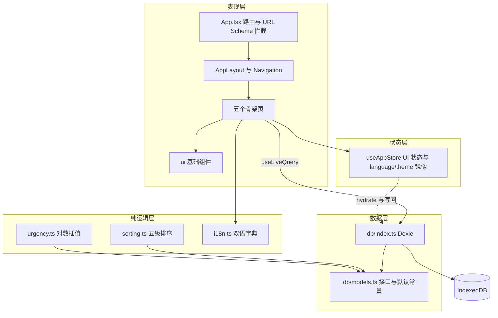

## 用户原始需求

用户提供《时光扣 TimePin 全栈 AI 开发总纲》，要求按其中严格的目录结构、字段契约、算法规则与界面规范，从零开发一款本地优先、离线完全可用的 PWA 任务管理应用，并先查看已备好的图片资源。经澄清，本轮仅交付总纲的 Step 1–3（基础层骨架），要求所有方案零成本、无需付费服务或账号密钥，具体技术取舍由 AI 自行设计，图片可按需改名；Step 4–9 顺延到后续轮次。

## 产品概述

「时光扣」以「紧急度」为核心：通过首次问卷校准用户对截止时间的紧迫感，据此为每个任务打分、划分四象限并智能排序。本轮交付可运行的应用骨架与底层能力，让后续页面功能可以逐块叠加、每块都能独立验证，而不是一次性堆砌全部界面。

## 核心功能

- 工程与视觉基座：完整目录骨架、全局样式与设计令牌（红橙灰主色、浅色与深色背景、卡片与按钮圆角、200ms 过渡）、品牌图片资源接入与规范命名。
- 本地数据能力：三张数据表与严格字段契约、默认设置自动初始化、问卷默认答案的回退读取，保证首次启动与空库状态均不出错。
- 紧急度与排序引擎：基于问卷答案的对数插值紧急度计算（含过期、无截止时间、区间两侧等边界处理），以及「置顶 → 已过期 → 四象限 → 权重得分 → 时间兜底」五级排序，配套覆盖边界的单元测试。
- 状态与界面骨架：全局界面状态、中英双语字典、底部导航与五个可切换页面骨架、深浅色与语言切换、快捷链接的参数预填拦截。
- 可验证性：安装、启动、构建、测试四条命令通过，浏览器中可切换五个页面并生效主题与语言。

## 视觉效果

浅色 #F9FAFB 与深色 #111827 背景，红色 #E5484D 为主强调色、橙色 #F5A623 与灰色 #6B7280 为辅；系统字体配合大标题与留白突出「今天」；卡片圆角柔和、标签胶囊化，点击与弹出均为 200ms 平滑过渡。底部为常驻四项导航（今天／日历／看板／设置），首次问卷为独立全屏卡片。本轮页面以整洁空状态与占位骨架呈现，风格统一、便于后续延展。

## 一、技术栈选型（全部开源免费、纯本地）

- 前端框架：React 18.3.x + TypeScript + Vite 5.4.x（与已核实的 Node v26.9.0 / npm 11.19.1 兼容）。
- 样式：Tailwind CSS 锁定 3.4.x + PostCSS + autoprefixer。总纲要求 `@tailwind` 注入与 `tailwind.config.js`，属 v3 语法；装到 v4 会导致配置整体失效，必须显式锁版本。
- 状态：Zustand 4/5，仅保存 UI 状态与语言／主题镜像；任务数据不进 store。
- 本地存储：Dexie 4.x + dexie-react-hooks 的 `useLiveQuery`，底层为浏览器 IndexedDB。
- 工具库：react-router-dom 6、date-fns、lucide-react、clsx、tailwind-merge。
- 测试：Vitest 2.x（总纲 Step 2 要求单测但未列框架，补入；开源免费）。
- 预留：`vite-plugin-pwa` 仅作为 devDependency 安装，本轮**不注册**到 Vite（原因见冲突说明），配置留到 Step 8。
- 明确不引入：Cloudflare Worker、VAPID 密钥、任何付费 API／账号体系；不提前安装 react-swipeable、framer-motion、file-saver。

## 二、实现策略与关键决策

**总体策略**：按「Step 1 数据基座 → Step 2 纯算法与单测 → Step 3 状态与界面骨架」三个可独立验证的阶段推进，每阶段跑通检查点再进入下一阶段；算法层做成不依赖 React 与浏览器时钟的纯函数，与 UI 解耦，便于单测与后续复用。

关键决策及取舍：

1. **非空目录脚手架**：根目录已有 11 张图片，`npm create vite@latest .` 会交互提示清空／覆盖。改为手写固定版本号的 `package.json` 与各配置文件后执行 `npm install`，用户原图无损保留。
2. **图片资源**：复制到 `public/` 并按规范命名（把 `splash-*.png` 改名为 `splash.png`，去掉真实星号字符），根目录 11 张原图保持不动；命名与 Step 8 的 manifest icons（192/512、maskable）对齐。
3. **总纲冲突 A（问卷永远触发不了）**：2.2 要求启动时写入 `urgencyProfile` 默认值，4.5 又要求「无该记录时强制跳转问卷」。方案：启动时 `ensureDefaults()` **只自动写入 settings**；把问卷默认答案导出为 `DEFAULT_URGENCY_ANSWERS`，`getUrgencyProfile()` 在无记录时返回内存构造的默认 profile（`isSkipped: false`）。既不修改既定 TypeScript 接口，又保证问卷拦截可触发。
4. **总纲冲突 B（语言双份真相）**：`AppSettings.language`（Dexie）与「Zustand 保存 language」重复。以 Dexie settings 为唯一持久化来源，Zustand 存镜像并在启动时 `hydrateFromSettings()`；`setLanguage`／`setTheme` 同步写回 Dexie。
5. **算法边界（Step 2 明确定义并写进单测）**：dueAt 为空返回 `noDue`；h 小于 0 返回 `expired`；`0 < h < 3` 落在首节点左侧、`h > 2160` 落在末节点右侧时**钳制到首／末节点分数，不外推**（避免 `Math.log(h)` 为负无穷与无相邻区间）；所有返回值统一 clamp 到 `[1.0, 5.0]` 并保留一位小数，`expired`／`noDue` 同样受限。可选 `now` 参数注入以便固定时钟测试。
6. **排序性能**：比较器内不调用 `Date.now()`、不重复算分。先一次遍历 decorate 出象限、权重得分、时间键，再单次 `sort`；`dueAt` 为 null 的时间兜底排最后，「已过期优先」仅作用于未完成任务。时间 O(n log n)、额外空间 O(n)。
7. **避免技术债**：严格沿用总纲目录与接口，不新增架构模式；本轮不注册 PWA 插件（`workbox` 运行时缓存属 `generateSW` 用法，而自定义 `src/sw.ts` 必须用 `injectManifest`，二者冲突，统一留到 Step 8）；占位页不引入业务依赖，保证 Step 4–9 可直接叠加。

**性能与可靠性**：全部读写在本地，复杂度 O(1) 至 O(n log n)，离线零网络延迟；`useLiveQuery` 结果按 tasks 与 settings 记忆化，避免每次渲染重排；`URGENCY_NODES` 提为模块常量避免重复建数组。错误面覆盖：空库、IndexedDB 不可用降级提示、非法 dueAt、非法 URL 参数。

## 三、执行要点（防回归）

- 无既有代码可复用，采用官方 Vite／React／Tailwind／Dexie／Zustand 标准写法；`cn()` 用 clsx + tailwind-merge 统一类名合并。
- `tailwind.config.js` 设 `darkMode: 'class'` 并 extend 主色、圆角、过渡；`index.css` 注入 `@tailwind`、系统字体栈与浅深色背景变量。
- Vitest 配置直接并入 `vite.config.ts` 的 `test` 字段，不额外新增配置文件，减少文件数。
- 不引入日志库、不打印任务内容；空库与存储不可用时给出可读空状态，避免控制台刷屏。
- 影响半径控制：仅新增文件，绝不改动或删除根目录 11 张原图；纯函数不触碰 UI；占位页只做导航与主题／语言切换。
- 验收命令：`npm install`、`npm run dev`、`npm run build`（tsc -b 与 vite build）、`npm test` 全部通过。
- 本轮明确不做：TaskCard／Today 业务渲染、TaskForm、问卷交互、Calendar 网格与年周日月视图、手势、`src/sw.ts` 与 PWA 注册、Web Push、导出 JSON。

## 四、架构设计（分层，Local-First）



数据流：用户操作 → Zustand 更新 UI 状态 → 业务数据由 Dexie 直接落 IndexedDB → `useLiveQuery` 推送新结果 → 纯函数 `sortTasks` 记忆化排序 → 页面重渲染。主题与语言由 Dexie settings 持久化、Zustand 镜像驱动。

## 五、目录结构（全部为新增文件）

### 根目录配置

```
timepin/
├── package.json              # [NEW] 固定版本依赖与 scripts：dev / build / preview / test；含 React18、vite5、tailwind3.4、dexie、zustand、vitest 等，不装付费或非本轮依赖
├── index.html                # [NEW] Vite 入口 HTML，接入 favicon.ico 与 apple-touch-icon.png，设置 viewport、theme-color、lang
├── vite.config.ts            # [NEW] react 插件、src 别名、@types/node、vitest test 字段；本轮刻意不注册 vite-plugin-pwa
├── tsconfig.json             # [NEW] 严格模式 TS 配置，路径别名与 DOM 类型
├── tsconfig.node.json        # [NEW] 供 vite.config.ts 使用的 Node 侧 TS 配置
├── postcss.config.js         # [NEW] tailwindcss 与 autoprefixer 插件（v3 用法）
├── tailwind.config.js        # [NEW] content 扫描、darkMode: 'class'、extend 主色 red #E5484D / orange #F5A623 / gray #6B7280、浅深背景、圆角与 200ms 过渡
├── .gitignore                # [NEW] 忽略 node_modules / dist / 本地环境文件
├── README.md                 # [NEW] 初始化与运行命令、Step 1–3 三条验收检查点、Step 4–9 顺延说明
└── public/                   # [NEW] 由根目录复制并规范命名的 11 张图：favicon.ico、apple-touch-icon.png、icon-192/512/1024.png、icon-maskable-192/512/1024.png、monochrome.png、timepin.png、splash.png；原 splash-*.png 改名，根目录原图保留
```

### src 目录

```
src/
├── main.tsx                  # [NEW] createRoot、BrowserRouter、全局样式引入；启动时 await ensureDefaults() 并 hydrate store
├── App.tsx                   # [NEW] 路由表 /、/calendar、/board、/settings、/onboarding，预留 /task/:id 与 /new；解析 ?title=&due= 存入 prefill 并打开表单状态；挂载深色 class
├── index.css                 # [NEW] @tailwind 注入、系统字体栈（中文系统字体优先，英文 -apple-system/BlinkMacSystemFont/Segoe UI/Roboto）、CSS 变量、基础过渡
├── vite-env.d.ts             # [NEW] Vite 客户端类型声明
├── db/
│   ├── models.ts             # [NEW] 严格照抄总纲 2.1 的 Importance / TaskStatus / Task / UrgencyProfile / AppSettings，字段名与联合类型一字不改；另导出 DEFAULT_URGENCY_ANSWERS、DEFAULT_APP_SETTINGS
│   └── index.ts              # [NEW] Dexie 子类，三表 tasks / urgencyProfile / settings 均以 id 为主键；ensureDefaults() 仅写 settings；getUrgencyProfile() 无记录时回退内存默认 profile；导出 db 实例
├── utils/
│   ├── urgency.ts            # [NEW] URGENCY_NODES 模块常量（8 节点）、calculateUrgency(dueAt, profile, now?)：对数插值、区间两侧钳制、clamp 到 1.0–5.0 并保留一位小数、详细注释
│   ├── sorting.ts            # [NEW] sortTasks(tasks, settings, now?) 与 quadrantOf()：置顶、已过期、Q1–Q4、权重得分降序、dueAt 升序兜底；decorate 预计算避免比较器重复开销
│   ├── i18n.ts               # [NEW] dict.zh / dict.en 字典对象，含 nav（today/calendar/board/settings/onboarding，补 board）、action（save/cancel/skip）、空状态与骨架页文案；导出 Lang 类型与取值辅助
│   ├── urgency.test.ts       # [NEW] Vitest：expired、noDue、节点精确命中、区间线性插值、左侧 0–3h 钳制、右侧超过 2160h 钳制、范围与一位小数
│   └── sorting.test.ts       # [NEW] Vitest：置顶优先、未完成过期优先、Q1→Q2→Q3→Q4、同象限权重得分降序、得分相同时 dueAt 升序、null dueAt 排末尾
├── store/
│   └── useAppStore.ts        # [NEW] Zustand：currentPage / isTaskModalOpen / editingTaskId / filter / language / theme / prefill 与对应 actions；不含任务数据；启动时 hydrate，语言主题写回 Dexie
├── components/
│   ├── ui/
│   │   ├── cn.ts             # [NEW] clsx + tailwind-merge 的类名合并工具
│   │   ├── Button.tsx        # [NEW] Tailwind 基础按钮（主色／幽灵变体、rounded-lg、transition-all duration-200）
│   │   ├── Input.tsx         # [NEW] 无边框与常规两种输入基础组件
│   │   └── Modal.tsx         # [NEW] 大尺寸模态容器占位，带 200ms 弹出过渡，供 Step 5 复用
│   ├── layout/
│   │   ├── AppLayout.tsx     # [NEW] 顶部标题栏 + 居中内容列（桌面限宽）+ 底部导航容器；浅深背景与安全区适配
│   │   └── Navigation.tsx    # [NEW] 常驻底部四项（今天／日历／看板／设置），lucide 图标、选中态红点高亮、i18n 文案
│   └── task/                 # [NEW] 空目录预留，供 Step 4／5 的 TaskCard 与 TaskForm 落位
├── hooks/                    # [NEW] 空目录预留，供后续 useTask / useNotification 落位
├── assets/                   # [NEW] 空目录预留（图片统一放 public，此目录留给后续音频等静态资源）
└── pages/
    ├── Today.tsx             # [NEW] 骨架：大字「今天」+ 日期副标题 + 搜索筛选图标占位；useLiveQuery 读空库并给出整洁空状态，预留 sortTasks 接入点，不渲染 TaskCard
    ├── Calendar.tsx          # [NEW] 骨架占位页：标题、分段控件外观占位、空状态文案（月视图留 Step 7）
    ├── Board.tsx             # [NEW] 骨架占位页：说明文案与空状态（总纲目录有此页但 9 步未覆盖，先承接导航）
    ├── Settings.tsx          # [NEW] 骨架页：可交互的深浅色三档与中英语言切换（作为主题／语言验收点），其余设置项占位
    └── Onboarding.tsx        # [NEW] 占位页：独立全屏卡片外观、右上角跳过按钮、分步进度与五个选项占位；本轮不做问卷交互与强制拦截
```

> 本轮**不创建** `src/sw.ts`、`manifest.json`、`TaskForm.tsx`、`TaskCard.tsx`、`file-saver` 相关代码；`vite-plugin-pwa` 仅安装不注册。

## 六、关键代码结构（接口级，不含实现）

新增契约一：全局状态（多个页面依赖，需精确定义）

```typescript
export type FilterKey = 'all' | 'today' | 'overdue';
export type ThemeMode = 'light' | 'dark' | 'system';
export type Lang = 'zh' | 'en';

export interface TaskPrefill {
  title?: string;
  due?: number | null;
}

export interface AppState {
  currentPage: string;
  isTaskModalOpen: boolean;
  editingTaskId: string | null;
  filter: FilterKey;
  language: Lang;
  theme: ThemeMode;
  prefill: TaskPrefill | null;
  setPage: (page: string) => void;
  openTaskModal: (prefill?: TaskPrefill, editingId?: string) => void;
  closeTaskModal: () => void;
  setFilter: (filter: FilterKey) => void;
  setLanguage: (language: Lang) => void;
  setTheme: (theme: ThemeMode) => void;
  hydrateFromSettings: (settings: AppSettings) => void;
}
```

新增契约二：算法与数据层函数签名（保持总纲语义，注入 now 便于测试）

```typescript
export interface UrgencyNode {
  hours: number;
  answerKey: keyof UrgencyProfile['answers'];
}
export const URGENCY_NODES: readonly UrgencyNode[];

export function calculateUrgency(
  dueAt: number | null | undefined,
  profile: UrgencyProfile,
  now?: number
): number;
export function clampScore(raw: number): number;

export function sortTasks(tasks: Task[], settings: AppSettings, now?: number): Task[];
export function quadrantOf(task: Task, threshold: number): 1 | 2 | 3 | 4;

// db/index.ts 中 ensureDefaults 与 getUrgencyProfile 均为 async 函数：
// 前者只写 settings；后者在无 urgencyProfile 记录时返回内存默认 profile，不落库。
```

## 设计定位

本轮为「时光扣」建立统一的应用外壳与设计令牌，页面本身是整洁的骨架／空状态，但视觉完成度要高：现代极简 + 轻层次卡片，红色 #E5484D 作唯一强强调，橙与灰作辅助，浅色 #F9FAFB 与深色 #111827 双主题。移动优先的 App Shell：内容居中限宽列，桌面端两侧留白；底部导航常驻固定并适配安全区。不引入组件库，Button／Modal／Input 由 Tailwind 自建，保证与总纲「不擅自发挥」一致。

## 页面规划（3 个骨架屏，共享 App Shell）

共享块：顶部标题栏（左大标题、右操作图标）+ 内容区 + 底部四项导航；深浅色与语言切换全局生效，所有交互带 200ms 过渡。

### 屏幕一：今日（骨架）

- 顶部栏：左侧大标题「今天」与日期副标题（农历位留空），右侧搜索与筛选图标，红色小点缀呼应品牌。
- 内容区：居中留白的空状态，使用 timepin.png 作品牌图形位，配一句引导文案。
- 列表预留位：声明任务卡片样式（左 4px 重要度色条、圆形复选框、胶囊标签、右侧紧急度徽标），本轮不渲染真实卡片。
- 底部导航：四项图标加文案，选中项红色高亮与圆点，安全区内边距。

### 屏幕二：设置（骨架）

- 顶部栏：标题「设置」与品牌图标，卡片分组留白统一。
- 外观分组：浅色／深色／跟随系统三档分段控件，圆角卡片容器。
- 语言分组：中文／English 切换，点击后整页文案即时刷新，作为双语验收点。
- 底部导航：与其他页完全一致，选中「设置」。

### 屏幕三：首次问卷（占位，特殊页不显示底部导航）

- 顶部栏：右上角胶囊「跳过」按钮，左侧进度指示。
- 进度块：分步圆点／细进度条，当前步高亮红色。
- 卡片块：居中大卡片，单题题干 + 五个选项按钮占位，圆角与柔阴影。
- 说明块：底部一句用途说明，浅色辅助文字，保持呼吸感。

## 响应式与动效

移动端单列、底部导航固定；桌面端内容列限宽居中并适度放大标题与间距；所有按钮、分段控件、模态弹出统一 200ms 平滑过渡；深色模式切换时背景与文字颜色平滑变化。图标统一 lucide 线性风格，尺寸与字重跨页一致。

## Agent Extensions

### Skill

- **playwright-cli**
- Purpose: 在 Step 3 骨架完成后启动本地 dev 服务，用浏览器自动化逐个访问五个路由并截图，操作深浅色与中英切换，核验底部导航选中态与文案刷新。
- Expected outcome: 产出五个路由均可达、导航高亮正确、主题与语言切换生效的可核验结果（含截图），作为本轮最终验收证据；若发现空白页或样式缺失则定位到具体页面。