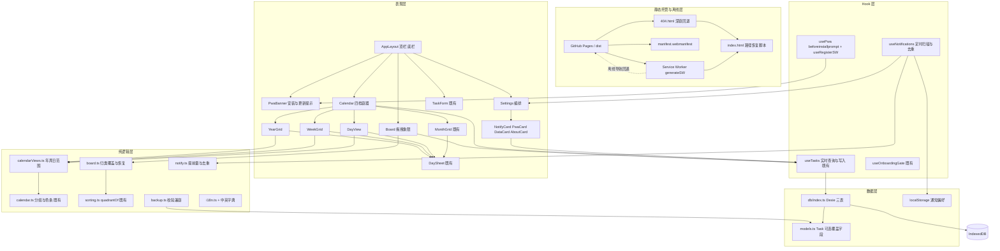

## 用户原始需求

「给我计划，制作最后一部分，就是把整体做出来」——把上一轮 README 中明确顺延的全部能力补齐，让「时光扣 TimePin」成为完整可交付的产品。经澄清确认：本轮**全部补齐**（PWA 可安装与离线缓存、年/周/日日历视图、拖拽看板、页面打开时的本地到期提醒、设置页完善）；提醒只做**打开页面时的本地提醒**（Notification API + 设置页开关与提前量，零后端零密钥、页面关闭后不提醒、不联网）；用户追问「这个后端 Supabase 做得了吗」，已答复「技术上能做但需同步任务到云端并引入账号体系，本轮先做 A，Supabase 几周后再评估」。

## 产品概述

在已完成的 Step 1–7 业务闭环、导出/导入 JSON 数据迁移、GitHub Pages 自定义域名自动发布之上，补齐最后一层：应用可安装到桌面、断网可打开、日历四种视图都能查任务、看板可拖拽归类、设置页提供真实的通知与数据管理控件、到期任务在页面打开时给本地提醒。发布后仍是纯静态、离线可用、无账号、无密钥、无后端的本地优先应用；README 改写为 Step 1–9 全量交付说明。

## 核心特性

- **PWA 离线安装**：自动生成 manifest 与 Service Worker，预缓存静态资源；应用内提供中英双语「安装到桌面」与「有新版本，点击更新」提示；复用 `public/` 现有 11 张图标。
- **日历四视图**：年（12 个月缩略格与任务数）、月（既有七列网格与色条）、周（7 列与每日清单）、日（当天时间轴与任务清单）均为真实数据，点击日期复用既有 Bottom Sheet 与编辑联动。
- **拖拽看板**：四象限支持原生 HTML5 拖拽归类与移动端等价按钮，人工归类可持久化、可一键恢复自动象限，不改任务时间与重要度。
- **本地到期提醒**：设置页开关、提前量、权限状态说明与测试提醒；定时扫描未完成任务、按任务与截止时间去重、点击通知走既有 `／task/:id` 路由；权限被拒或环境不支持时给可读降级。
- **设置页完善**：静态说明卡升级为通知设置、PWA 与离线状态、重新校准问卷、回收站与清空本机数据（带确认）、版本与离线说明等真实控件。
- **回归与文档**：保持既有问卷拦截、URL Scheme 预填、导出/导入、离线农历、左右滑手势、深浅色与中英切换、GitHub Actions 发布链路全部通过；文档说明 PWA 离线与提醒边界，明确 Web Push、VAPID、Workers、Supabase 继续顺延。

## Tech Stack Selection

完全复用现有工程、零新增运行时依赖：React 18.3 + TypeScript 5.6 + Vite 5.4 + Tailwind CSS 3.4.17 + Zustand 5 + Dexie 4（`useLiveQuery`）+ react-router-dom 6 + date-fns 4 + lucide-react + Vitest 2。PWA 使用**已在 devDependencies 中的** `vite-plugin-pwa@^0.21.1`；拖拽用原生 HTML5 Drag and Drop；提醒用浏览器 Notification API 与定时器；农历仍用 `src/utils/lunar.ts` 的零依赖方案。不引入组件库、拖拽库、通知库、i18n 库、file-saver 或任何后端 SDK。构建入口保持 `tsc --noEmit && vite build`，部署仍为 `.github/workflows/deploy.yml` 上传 `dist` 到 GitHub Pages。

## Implementation Approach

**总体策略**：沿用「纯逻辑层 + UI 编排层」既有架构，把新功能的可测规则抽成不依赖 React 与浏览器时钟的纯函数（`calendarViews.ts`、`board.ts`、`notify.ts`），`now` 一律由参数注入；UI 只消费 `useTasks()`、`useDict()`、`useAppStore()`。按「契约与纯逻辑 → PWA → 日历 → 看板 → 提醒与设置 → 全量验收」推进，每阶段独立跑类型、单测与构建。

**关键技术决策与取舍**：

1. **PWA 用 `generateSW`，不写自定义 `src/sw.ts`**。本轮不做 Web Push，因此不需要 `injectManifest` 自定义 SW（上一轮已记录 `generateSW` 与自定义 `src/sw.ts` 的 workbox 配置冲突）。SW 只做静态资源 precache 与离线导航回退，绝不监听 `push` / `notificationclick`，不引入 VAPID。配置要点：`registerType: 'autoUpdate'`、`injectRegister: null`（改由 `virtual:pwa-register/react` 的 `useRegisterSW` 单点注册，避免重复注入）、`workbox.navigateFallback: '/index.html'`、`globPatterns` 只匹配 `js/css/html/ico/png/webmanifest` 并排除 `404.html`、`CNAME`、`.nojekyll`、`sw.js` 自身。`index.html` 只手写 apple-mobile-web-app 系列 meta，manifest link 由插件自动注入（不重复添加）；新增 `src/vite-env.d.ts` 引用 `vite-plugin-pwa/client` 类型。
2. **SW 与既有 404 深链回退双通道兼容（最高风险）**。在线且 SW 已激活时，`/calendar` 等导航被 SW 直接以缓存的 `index.html` 响应（200，URL 保持原样，React Router 正常渲染）；首次访问或 SW 未激活时走 `public/404.html` → `sessionStorage` → `index.html` 恢复脚本 → `history.replaceState`。两条路径都必须保留且不得修改恢复脚本的位置（模块脚本之前）。验收需覆盖在线刷新与断网刷新。
3. **提醒不依赖自定义 SW 代码**。使用页面内 `new Notification(title, options)` 并在 `onclick` 里 `window.focus()` + `navigate('/task/' + id)`，复用现有 `TaskDetailRedirect`；刻意**不用** `registration.showNotification()`，因为它要求 SW 内写 `notificationclick` 监听，会破坏「零自定义 SW」决策。
4. **提醒偏好存 `localStorage`（独立键 `timepin:notify`）**，不改 Dexie schema、不改 `AppSettings` 接口、不改 `BACKUP_SCHEMA_VERSION`。通知授权是浏览器级能力，开关、提前量、已提醒去重记录都不属于用户任务数据，不进入导出/导入 JSON，也避免牵动 `backup.ts` 的 `validSettings` 严格校验与默认值。
5. **拖拽语义用可选人工覆盖字段**。`quadrantOf` 由 `urgencyScore` + `importance` 自动计算，直接拖拽改象限会破坏算法一致性。给 `Task` 增加**可选**字段 `boardQuadrant?: 1 | 2 | 3 | 4`；`Board.tsx` 分组优先读该字段、无覆盖回退 `quadrantOf`；`sorting.ts` 与首页排序完全不变；`backup.ts` 的 `validTask` 允许该可选字段（仅接受 1–4）。因此**不需要升 `db.version(1)`、不需要升 `BACKUP_SCHEMA_VERSION`**，旧备份向后兼容、新备份可被旧逻辑识别。拖拽复用 `useTasks().updateTask(id, patch)` 单条写入，不整表重写。
6. **字典按模块再拆以守住 300 行上限**。现有 `dictionaries.zh.ts` / `.en.ts` 约 217 行，本轮新增 PWA、提醒、年周日视图、拖拽、设置控件等大量文案必然超限。在 `i18n.ts` 中把 `Dictionary` 定义为 `BaseDictionary & FeatureDictionary` 交叉类型并扩展新分组；新增 `dictionaries.feature.zh.ts` / `dictionaries.feature.en.ts` 承载新文案；两行桶文件 `dictionaries.ts` 改为合并 `zhBase` 与 `zhFeature`（en 同理）后导出 `{ zh, en }`，保持 `i18n.ts` 的 `import { en, zh } from './dictionaries'` 不变。zh/en 键结构严格一致，页面不硬编码任何文案。

**性能与可靠性**：`groupTasksByDate` 已是 O(n) 单次遍历，年/周/日视图复用同一 Map，按日期键 O(1) 查找，不为每月或每天重算分组；`useMemo` 记忆化分组与视图数据，避免 Dexie 实时查询后的重复遍历。提醒定时器 60 秒单次扫描 O(n)，已提醒集合用 Set 做 O(1) 去重，仅在 `visibilityState === 'visible'`、权限 `granted`、开关开启时运行，卸载时清理；去重键只保留最近若干条，避免 localStorage 无限增长。拖拽为单条 `updateTask`，无 N+1 写入。SW precache 只缓存静态资源，不缓存 IndexedDB 数据，不占存储配额。复杂度瓶颈在 `useLiveQuery` 每次写入后的重跑，用记忆化与稳定 `now` 控制，本地小数据量不引入虚拟列表。

**避免技术债**：不升 Dexie 版本、不改 `AppSettings`、不改备份 schema 版本、不引入新架构模式；所有浏览器能力不可用时（Notification 被拒、非安全上下文、`beforeinstallprompt` 不触发、SW 不支持）给可读降级而非白屏；Dexie 与文件操作统一 `.catch((error) => console.error('[timepin] ...', error))`，不用 `try/catch`，日志不含任务正文或 PII。

## Implementation Notes

- **复用既有符号**：`src/utils/calendar.ts` 的 `dateKey`、`dateKeyOf`、`groupTasksByDate`、`barsForDay`、`colorForImportance`；`src/utils/sorting.ts` 的 `quadrantOf(task, threshold): Quadrant`；`src/hooks/useTasks.ts` 的 `updateTask(id, patch: Partial&lt;Task&gt;)`；`src/components/ui/Modal.tsx` 的 `variant: 'center' | 'sheet'` 与 `footer`；`src/components/calendar/DaySheet.tsx` 的 props（`date / tasks / colorMap / threshold / language / onClose / onEdit`）；`src/utils/i18n.ts` 的 `interpolate` 与 `useDict`；`src/index.css` 的 `tp-surface / tp-pill / tp-muted / tp-border / tp-divider / tp-segment / tp-focus / tp-colorbar / tp-sheet`。不要新建平行组件体系。
- **回归影响面**：`Task` 新增可选字段后，`backup.ts` 的 `validTask` 必须放行，否则旧导出文件在导入时会被误判；`Dictionary` 扩展后两份字典必须同步，否则 TypeScript 立刻报错；`public/404.html`、`index.html` 恢复脚本、`vite.config.ts` 的 `base: env.VITE_BASE || '/'`、`CNAME`、`.nojekyll`、`.github/workflows/deploy.yml` 一律保持可工作。
- **PWA 注册单点**：`injectRegister: null` 与 `useRegisterSW` 必须配对，否则会重复注册导致 `onNeedRefresh` 行为异常；`devOptions.enabled: true` 仅用于本地验收，生产以 `dist/sw.js` + `dist/manifest.webmanifest` 为准。
- **通知与问卷门禁**：提醒 hook 挂在主应用外壳（`AppLayout`）内，避免在首次问卷页弹出提醒；仅在用户点击开启时调用 `Notification.requestPermission()`；重新校准问卷通过删除 `urgencyProfile` 的 `default` 记录触发既有 `useOnboardingGate` 实时跳转，需带二次确认。
- **日志与降级**：权限被拒、浏览器不支持、非 HTTPS、存储不可用分别给字典中的可读文案；错误统一 `console.error('[timepin] ...', error)`，不打印任务标题；验收要求控制台 0 错误 0 警告。
- **范围控制**：不创建 Git 仓库、不 commit、不 push、不改根目录 11 张原图；截图与快照归档到 `.playwright-cli/`（已在 `.gitignore`），临时静态服务器与浏览器会话收尾清理。

## Architecture Design

本轮在既有分层上增加三个纯逻辑模块与一个 Service Worker 旁路基，数据流不变：Dexie 仍是唯一数据源，Zustand 仍是 UI 状态镜像，SW 只参与静态资源分发、不参与数据读写。



数据流：用户操作 → Zustand 打开表单/切换视图 → 纯函数计算分组、象限覆盖与提醒判定 → `useTasks().updateTask` 写入 Dexie → `useLiveQuery` 推送 → `useMemo` 重渲染。SW 与 404 回退只影响 HTML 分发，不触碰 IndexedDB；通知偏好只在 localStorage，不进入备份 JSON。

## Directory Structure

以下为本轮全部新增与修改文件；根目录 11 张原图与 `public/` 内既有图片保持不动。

```
timepin/
├── vite.config.ts                          # [MODIFY] 在 plugins 中注册 VitePWA：generateSW、registerType autoUpdate、injectRegister null、完整 manifest（名称/双语简介/start_url '/' /scope '/' /standalone/theme_color #E5484D/现有 192、512、maskable 图标）、workbox.navigateFallback '/index.html' 与 globPatterns；保留 base、@ 别名、server、Vitest 字段
├── index.html                              # [MODIFY] 仅新增 apple-mobile-web-app-capable、status-bar-style、title 等 meta；manifest link 由插件自动注入不得重复；SPA 路径恢复脚本位置与内容保持不变
├── src/vite-env.d.ts                       # [NEW] 引用 vite-plugin-pwa/client 类型，保证 virtual:pwa-register/react 有类型；同时保留 Vite 默认环境声明
├── src/main.tsx                            # [MODIFY] 保持 StrictMode、BrowserRouter、ensureDefaults 与 hydrateFromSettings；不在此重复注册 SW（由 usePwa 单点注册）
├── src/index.css                           # [MODIFY] 增补提示条、年视图缩略格、周/日时间轴、拖拽源与投放高亮、通知开关禁用态等少量类；保留现有 CSS 变量、令牌类与 200ms 动效
├── src/App.tsx                             # [MODIFY] 保持问卷 gate、快捷链接捕获与路由表不变；确认 /task/:id 可被本地通知点击复用
├── src/components/layout/AppLayout.tsx      # [MODIFY] 挂载 PwaBanner 与 useNotifications（主应用区生效，问卷页不弹提醒）；顶栏、搜索、底栏与 TaskForm 编排保持不变
├── src/components/layout/PwaBanner.tsx      # [NEW] 中英双语安装提示与更新提示条；消费 beforeinstallprompt 与 onNeedRefresh，提供安装、更新、稍后三个真实 button，失败给可读降级
├── src/hooks/usePwa.ts                     # [NEW] 封装 useRegisterSW（autoUpdate）、beforeinstallprompt 事件捕获与延迟 prompt、离线就绪状态；事件监听在卸载时清理
├── src/hooks/useNotifications.ts           # [NEW] 读取 localStorage 偏好，60 秒定时扫描未完成任务、去重、构造通知并绑定 onclick 跳转 /task/:id；仅可见且已授权且开关开启时运行；卸载清理定时器与监听
├── src/utils/notify.ts                     # [NEW] 纯逻辑：NotifyPreferences 结构、提前量选项、shouldNotify(task, now, leadMinutes, seen) 判定、去重键生成与裁剪、通知文案数据；now 由参数注入
├── src/utils/notify.test.ts                # [NEW] 单测：提前量边界、已完成与回收站排除、无截止时间、去重命中与 dueAt 变更后可再次提醒、裁剪上限
├── src/utils/board.ts                      # [NEW] 纯逻辑：resolveQuadrant(task, threshold) 优先读 boardQuadrant 再回退 quadrantOf、assignQuadrant 与 clearOverride 的 patch 构造、合法值校验
├── src/utils/board.test.ts                 # [NEW] 单测：自动象限回退、人工覆盖生效、非法值忽略、清除覆盖、不改变时间字段
├── src/utils/calendarViews.ts              # [NEW] 纯逻辑：buildYearMonths(year)、buildWeekDays(anchor)、buildDaySlots(date)、范围内日期键列表与任务计数；周一为首列、now 由参数注入
├── src/utils/calendarViews.test.ts         # [NEW] 单测：跨年、闰年二月、周一首列、跨月周、日视图时间槽、范围与空数据
├── src/utils/calendar.ts                   # [MODIFY] 保持既有 dateKey/groupTasksByDate/barsForDay 不变；如有共享 helper 仅做最小补充，确保 calendar.test.ts 9 个用例全绿
├── src/components/calendar/YearGrid.tsx    # [NEW] 12 个月缩略网格，每月显示任务数与重要度色点，可前后切年、点击月份进入月视图；复用 groups 与 colorMap
├── src/components/calendar/WeekGrid.tsx    # [NEW] 7 列周视图，可前后切周，每日列出任务并复用色条与 DaySheet 选择逻辑
├── src/components/calendar/DayView.tsx     # [NEW] 当天时间轴与任务清单，按小时分组、显示截止时间与象限徽标，点击任务进入编辑
├── src/components/calendar/MonthGrid.tsx   # [MODIFY] 接口与渲染保持不变，仅供四档容器复用
├── src/components/calendar/DaySheet.tsx    # [NEW→保持] 既有贴底面板不改接口，供年/周/日/月四档共用
├── src/pages/Calendar.tsx                  # [MODIFY] 移除三档占位说明卡，改为年/月/周/日真实视图编排；统一管理 cursor（年、月、周锚点、日）、selection 与 DaySheet；说明卡改为各视图可读提示
├── src/pages/Board.tsx                     # [MODIFY] 四象限改为可投放区域，任务行 draggable，原生 dragstart/dragover/drop 调用 updateTask 写入 boardQuadrant；移动端提供等价「移动到象限」按钮；提供「恢复自动排序」清除覆盖；保留只读时的数据与配色
├── src/components/settings/SettingsNotifyCard.tsx  # [NEW] 通知开关（点击才请求权限）、提前量分段控件、权限状态说明、测试提醒按钮、页面关闭不提醒的边界说明
├── src/components/settings/SettingsPwaCard.tsx     # [NEW] 安装到桌面、离线可用状态、新版本更新入口与当前构建版本信息
├── src/components/settings/SettingsDataCard.tsx    # [NEW] 重新校准紧急度问卷（带确认）、回收站列表（恢复与彻底删除）、清空本机数据（二次确认）、本地数据说明
├── src/components/settings/SettingsAboutCard.tsx   # [NEW] 版本、离线与无账号说明，替换原静态关于卡
├── src/pages/Settings.tsx                  # [MODIFY] 瘦身为编排：外观/语言区与 BackupCard 保持不变，原三张静态说明卡替换为上述四个卡片组件
├── src/db/models.ts                        # [MODIFY] Task 增加可选 boardQuadrant?: 1 | 2 | 3 | 4；DEFAULT_* 与 AppSettings、UrgencyProfile 不变
├── src/db/index.ts                         # [MODIFY] 保持 db.version(1) 与三表索引不变（可选字段无需索引、无需迁移）；快照读写函数保持不变
├── src/utils/backup.ts                     # [MODIFY] validTask 放行可选 boardQuadrant（仅 1–4，undefined 视为合法）；BACKUP_SCHEMA_VERSION 保持 1
├── src/utils/backup.test.ts                # [MODIFY] 增补含/不含 boardQuadrant 的备份往返与非法值拒绝用例；既有 9 个用例全绿
├── src/utils/i18n.ts                       # [MODIFY] 把 Dictionary 拆为 BaseDictionary & FeatureDictionary 交叉类型，扩展 pwa、notify、calendarViews、boardDrag、settingsExtra 等分组；保留 Lang、dict、getDict、useDict、interpolate 全部导出
├── src/utils/dictionaries.ts               # [MODIFY] 由两行再导出改为合并 zhBase+zhFeature、enBase+enFeature 后导出 { zh, en }，import 路径不变
├── src/utils/dictionaries.zh.ts            # [MODIFY] 类型改为 BaseDictionary，既有文案不动
├── src/utils/dictionaries.en.ts            # [MODIFY] 类型改为 BaseDictionary，既有文案不动
├── src/utils/dictionaries.feature.zh.ts    # [NEW] 本轮新增全部中文文案（PWA 提示、通知、年周日视图、拖拽、设置控件、边界说明），键结构与英文一致
├── src/utils/dictionaries.feature.en.ts    # [NEW] 结构完全一致的真实英文文案，非占位文本
├── README.md                               # [MODIFY] 改为 Step 1–9 全量交付说明；新增 PWA 安装与离线策略、提醒边界（页面关着不推送需服务器与 VAPID、Supabase 阶段再评估且需云端同步与账号）、更新验收检查点、清空旧顺延清单并列出新顺延项
├── .github/workflows/deploy.yml            # [保持] 不改流程；确认 npm ci 能安装已声明的 vite-plugin-pwa、dist 仍含 .nojekyll、CNAME、404.html、manifest、sw.js
├── public/404.html                         # [保持] 深链回退逻辑不改，与 SW 导航回退双通道共存
├── public/CNAME                            # [保持] timepin.tools.leleleling.site 不动
└── public/.nojekyll                        # [保持] 空文件不动
```

## Key Code Structures

仅列出跨模块依赖最多、最易写错的三个契约（接口级，不含实现）：

```typescript
// src/db/models.ts 与 src/utils/board.ts
export type BoardQuadrant = 1 | 2 | 3 | 4;

// Task 新增可选字段：旧数据、旧备份无需迁移
// boardQuadrant?: BoardQuadrant;

export function resolveQuadrant(task: Task, threshold: number): BoardQuadrant;
export function assignQuadrantPatch(quadrant: BoardQuadrant): Partial&lt;Task&gt;;
export function clearQuadrantPatch(): Partial&lt;Task&gt;;
```

```typescript
// src/utils/notify.ts
export interface NotifyPreferences {
  enabled: boolean;
  leadMinutes: number;      // 0 / 15 / 60 / 1440
  seenKeys: string[];       // 形如 id:dueAt，限制长度
}

export function shouldNotify(
  task: Task,
  now: number,
  leadMinutes: number,
  seen: Set&lt;string&gt;,
): boolean;

export function notificationKey(task: Task): string;
export function trimSeenKeys(keys: string[], limit: number): string[];
```

```typescript
// src/utils/i18n.ts（拆分方式，保持既有导出名不变）
export type Dictionary = BaseDictionary & FeatureDictionary;
// dictionaries.ts 合并后导出 { zh, en }，i18n.ts 仍 import { en, zh } from './dictionaries'
```

## 设计风格

延续「现代极简 App Shell」：浅色 #F9FAFB 与深色 #111827 双主题，红色 #E5484D 为唯一强强调，橙 #F5A623 与灰 #6B7280 辅助；轻层次卡片（tp-surface）、柔阴影、胶囊标签、红色渐变 Hero。全部用现有 Tailwind 令牌与自建 Button / Input / Modal / cn，不引入组件库，不新增设计体系。所有点击、视图切换、拖拽投放、提示条升起与主题切换统一 `transition-all duration-200`，尊重减少动效偏好；拖拽源降低不透明度、投放象限用主色描边与浅色底高亮，松手后 200ms 归位。

## 页面规划（5 个屏幕，共享固定顶栏与固定底部导航）

### 屏幕一：日历年视图

- 顶栏：品牌图标、标题「日历」、语言/深色/搜索/加号按钮，半透明模糊，与全站一致。
- 分段控件：年 / 月 / 周 / 日四枚胶囊，选中态红色实心，切换带 200ms 淡入。
- 年份导航：上一年、年份标题、下一年，右侧显示全年任务总数胶囊。
- 12 月缩略网格：3×4 卡片，每月显示周首列小格、任务数徽标与最多三条重要度色点；点击整块进入月视图。
- 说明与底栏：颜色对应重要度的图例说明卡；底部四项导航选中「日历」。

### 屏幕二：日历周视图

- 顶栏与分段控件：同上，保持跨视图一致的交互锚点。
- 周导航：上一周、周范围标题、下一周，含「回到本周」按钮。
- 七列日卡：周一至周日，今日红色圆形高亮，每列列出当天任务标题与 3px 色条，空日显示浅色占位。
- Bottom Sheet：点击任一列复用 DaySheet 列出当天全部任务与象限徽标，可点进编辑。
- 底栏：与其他页面完全一致，选中「日历」。

### 屏幕三：日历日视图

- 顶栏与分段控件：同上，保持一致性。
- 日期导航：上一天、大号日期与农历副标题、下一天，右侧当日任务数胶囊。
- 时间轴：按小时分组的纵向刻度，任务按截止时间落位，左侧 4px 重要度色条与右侧紧急度徽标。
- 空状态与快速新建：无任务时给品牌图形与具体引导，主色「新建任务」按钮。
- 底栏：选中「日历」，内容区保持 pt-24 pb-28 不被遮挡。

### 屏幕四：拖拽看板

- 顶栏与说明卡：标题「看板」、一段说明「可按自己的判断把任务拖到任意象限」。
- 四象限网格：桌面双列、移动单列，每象限含主色边条、标题、条数胶囊与描述，投放时描边高亮。
- 任务行：draggable 卡片，含置顶圆点、标题、重要度色点；移动端附「移动到」下拉按钮作为等价操作。
- 覆盖标记与恢复：人工归类的任务显示「手动」小胶囊，「恢复自动排序」按钮一键清除覆盖。
- 底栏：选中「看板」，拖拽时底栏保持固定不位移。

### 屏幕五：设置（完善后）

- 顶栏与外观区：标题「设置」，浅色/深色/跟随系统与中文/English 分段控件，即时生效。
- 数据迁移区：既有 BackupCard，浅橙换域名提示、导出与导入确认保持不变。
- 通知与 PWA 区：通知开关、提前量分段、权限状态与测试提醒；安装到桌面、离线状态与版本更新入口，均为真实控件。
- 数据与关于区：重新校准问卷、回收站列表（恢复/彻底删除）、清空本机数据二次确认、版本与无账号离线说明。
- PWA 提示条与底栏：安装/更新提示固定在内容区顶部下方，不遮挡顶栏；底栏选中「设置」。

## Agent Extensions

### SubAgent

- **code-explorer**
- Purpose: 在改动 `Task` 类型与 `Dictionary` 契约前，全量核查所有引用点（validTask、useTasks、sorting、calendar、backup 测试、两份字典、各页面取词），输出回归影响面清单。
- Expected outcome: 明确列出必须同步修改的文件与「无需改动」的文件，避免可选字段导致备份校验误判或字典键不一致引发类型错误。

### Skill

- **playwright-cli**
- Purpose: 在开发服务与生产构建预览上做端到端验收：PWA 注册与离线断网刷新、manifest 与图标、安装/更新提示、年/周/日三档真实数据、拖拽持久化与恢复自动、通知开关与权限降级、深链 404 回退在线与离线双通道、中英双主题、390px 移动端无溢出、控制台 0 错误 0 警告。
- Expected outcome: 产出全流程可核验结果与截图，证明最后一部分功能与既有能力均按预期工作；截图归档到 `.playwright-cli/`，临时服务器与浏览器会话收尾清理。